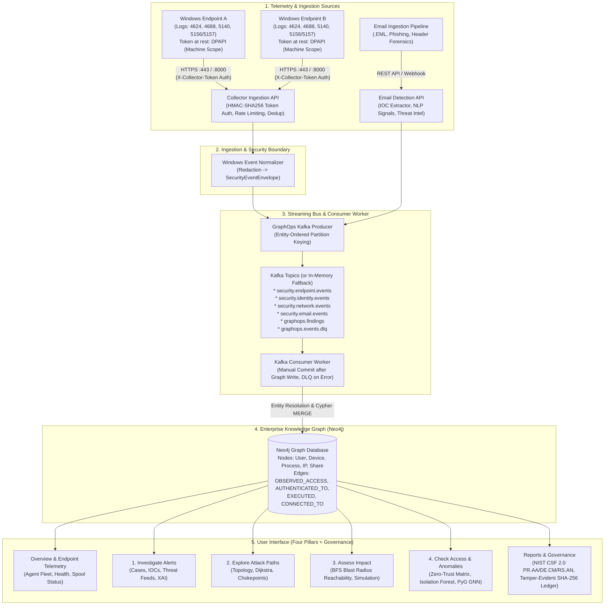

# ThreatLens GraphOps — Architecture & Module Map

## 1. Executive Summary & Platform Mission

**ThreatLens** is an enterprise-grade **Cyber Threat Investigation, Graph Analytics, and Remote Endpoint Telemetry Platform**. It bridges endpoint security telemetry (Windows Event Logs), inbound communications (Email Forensics), identity access governance (Zero-Trust), and graph-based threat analysis into a unified detection and response fabric.

Instead of treating alerts as isolated log entries, ThreatLens projects every user, device, process, network connection, IP, domain, and file into an **Enterprise Knowledge Graph (Neo4j)**, applying deterministic graph algorithms (**Dijkstra**, **BFS**, **PageRank**, **Betweenness Centrality**) and machine learning (**Isolation Forest**, **PyG Structural GNN**) to trace potential attack trajectories, compute blast radius reachability, and detect lateral movement anomalies in real time.

---

## 2. High-Level Data Journey & System Topology



---

## 3. Module Inventory across Workspaces

### Workspace 0: Overview & Endpoint Telemetry Management
*Primary Files: [`collector/threatlens_collector.py`](file:///C:/Users/Dhayanithi%20M%20U/.gemini/antigravity/worktrees/ThreatLens/remote_windows_log_collection/collector/threatlens_collector.py), [`backend/collector/registry.py`](file:///C:/Users/Dhayanithi%20M%20U/.gemini/antigravity/worktrees/ThreatLens/remote_windows_log_collection/backend/collector/registry.py), [`backend/collector/normalizer.py`](file:///C:/Users/Dhayanithi%20M%20U/.gemini/antigravity/worktrees/ThreatLens/remote_windows_log_collection/backend/collector/normalizer.py), [`backend/api/collector_routes.py`](file:///C:/Users/Dhayanithi%20M%20U/.gemini/antigravity/worktrees/ThreatLens/remote_windows_log_collection/backend/api/collector_routes.py)*

The **Overview Workspace** provides global security posture metrics, high-level summary cards, and the management console for registered Windows endpoints.

* **Collector Device Registry (`backend/collector/registry.py`)**:
  * **Operations**: Enrolls endpoints, generates 288-bit cryptographic tokens (stored at rest on the server as HMAC-SHA256 digests), tracks `last_seen` heartbeats, counts accepted events, and handles instant token revocation.
  * **Concurrency Protection**: Protected by cross-process file locking via `filelock` and atomic `.tmp` file replacement, safely supporting multi-worker Uvicorn configurations.
  * **Auto-Provisioning**: Enrolling an endpoint provisions or updates a `(:Device)` node in Neo4j with its hostname, IP address, and OS metadata.
* **Lightweight Windows Collector (`collector/threatlens_collector.py`)**:
  * **Operations**: Runs as a Windows background Scheduled Task (or interactive console agent). Reads security channel events using `pywin32` with native `wevtutil.exe` XML fallback.
  * **Transport vs. Local Protection**:
    * **Transport Authentication**: Sends batches over HTTPS with HTTP request headers `X-Collector-ID` and `X-Collector-Token`.
    * **At-Rest Protection**: On the endpoint, the token is encrypted on disk in `config.json` via Windows DPAPI (`CryptProtectData`) using machine scope (`CRYPTPROTECT_LOCAL_MACHINE`), allowing the collector task running as `NT AUTHORITY\SYSTEM` to decrypt in memory while NTFS ACLs restrict file read access to `SYSTEM` and `Administrators`.
  * **Durable Spool Queue & Recovery (`SpoolManager`)**:
    * If the network drops or backend is unavailable, incoming events are written to a bounded (20 MB default) disk queue in `C:\ThreatLensCollector\spool`.
    * Spooled batches are drained in FIFO order upon reconnection.
    * Event checkpoints advance only after verified HTTPS acceptance (HTTP 200) or durable on-disk spool persistence, preventing log loss across reboots.
* **Windows Event Normalization & Redaction (`backend/collector/normalizer.py`)**:
  * **Credential Scrubbing**: Sanitizes CLI arguments (`--password`, `-p`, `ghp_token`, `access_token`) on both the collector side and the backend normalizer before Kafka queuing.
  * **Anti-Spoofing Enforcement**: Replaces any claimed computer name with the verified `hostname` bound to the authenticated `collector_id`.
  * **Supported Windows Event IDs**:
    * **Logon & Identity**: Event `4624` (Successful Logon), Event `4625` (Failed Logon), Event `4672` (Special Privileges Assigned).
    * **Process Tracking**: Event `4688` (Process Creation with mandatory Audit Process Creation and command-line logging).
    * **Account Management**: Event `4720` (User Created), Event `4726` (User Deleted), Event `4738` (User Modified).
    * **Network Share Access (Event 5140)**: Windows Security file share object auditing (`\\*\SYSVOL`, `\\*\C$`, `\\*\data`). Captures `SubjectUserName`, `ShareName`, `ShareLocalPath`, client `IpAddress`, and `AccessMask` permissions.
    * **Windows Filtering Platform Network Connections (Events 5156 & 5157)**: Fired by the kernel WFP driver. Event `5156` represents an allowed socket connection (`blocked: false`), while Event `5157` represents a blocked socket connection (`blocked: true`). Captures binary `Application`, `Direction`, `SourceAddress`, `SourcePort`, `DestAddress`, and `DestPort`.

---

### Workspace 1: Investigate Alerts (Alerts, Cases & Threat Intel)
*Primary Files: [`backend/services/threat_detection.py`](file:///C:/Users/Dhayanithi%20M%20U/.gemini/antigravity/worktrees/ThreatLens/remote_windows_log_collection/backend/services/threat_detection.py), [`backend/services/email_forensics.py`](file:///C:/Users/Dhayanithi%20M%20U/.gemini/antigravity/worktrees/ThreatLens/remote_windows_log_collection/backend/services/email_forensics.py), [`backend/services/ioc_extractor.py`](file:///C:/Users/Dhayanithi%20M%20U/.gemini/antigravity/worktrees/ThreatLens/remote_windows_log_collection/backend/services/ioc_extractor.py), [`backend/services/threat_intelligence/`](file:///C:/Users/Dhayanithi%20M%20U/.gemini/antigravity/worktrees/ThreatLens/remote_windows_log_collection/backend/services/threat_intelligence/), [`backend/services/explainable_ai.py`](file:///C:/Users/Dhayanithi%20M%20U/.gemini/antigravity/worktrees/ThreatLens/remote_windows_log_collection/backend/services/explainable_ai.py)*

Provides triage capabilities for security analysts investigating suspicious communications, phishing campaigns, and correlated alert cases.

* **Email Forensics & Heuristics (`email_forensics.py`, `nlp_signals.py`)**:
  * Parses raw `.eml` MIME bodies, extracting header routing, SPF/DKIM/DMARC authentication results, and attachment metadata.
  * Evaluates linguistic urgency, payment/gift card solicitation, lookalike spoofing, and CEO impersonation patterns.
* **Automated IOC Extraction & Threat Intelligence Aggregation (`ioc_extractor.py`, `aggregator.py`)**:
  * Extracts IP addresses, domain names, URLs, and SHA-256 hashes using strict regex and validation patterns.
  * Queries external reputation sources (VirusTotal API, AbuseIPDB) with in-memory TTL caching (`cache.py`) to prevent external rate-limit exhaustion.
* **Risk Scoring & Classification (`scoring_engine.py`, `threat_classifier.py`)**:
  * Fuses header signals, NLP scores, and threat intelligence scores into a normalized 0–100 risk score and severity (`LOW`, `MEDIUM`, `HIGH`, `CRITICAL`).
* **Explainable AI (XAI) (`explainable_ai.py`)**:
  * Produces transparent explanations breaking down exactly which factors contributed to an alert score (e.g., "High Risk (88/100): SPF fail, domain registered 2 days ago, and financial wire instructions detected").

---

### Workspace 2: Explore Attack Paths (Topology, Dijkstra & Chokepoints)
*Primary Files: [`backend/graphops/dijkstra.py`](file:///C:/Users/Dhayanithi%20M%20U/.gemini/antigravity/worktrees/ThreatLens/remote_windows_log_collection/backend/graphops/dijkstra.py), [`backend/graphops/attack_paths.py`](file:///C:/Users/Dhayanithi%20M%20U/.gemini/antigravity/worktrees/ThreatLens/remote_windows_log_collection/backend/graphops/attack_paths.py), [`backend/graphops/centrality.py`](file:///C:/Users/Dhayanithi%20M%20U/.gemini/antigravity/worktrees/ThreatLens/remote_windows_log_collection/backend/graphops/centrality.py)*

Models network connectivity, privilege relationships, and potential lateral movement routes between assets.

* **Dijkstra Shortest Path Engine (`dijkstra.py`)**:
  * Computes the least-cost potential path between an entry-point node and a high-value crown jewel (e.g. Domain Controller, SQL server).
  * Dynamic edge costs reflect credential exposure, protocol vulnerability, and session hijacking risk.
* **Depth-First Path Traversal (`attack_paths.py`)**:
  * Explores alternative lateral movement branches within configurable depth limits (1–5 hops).
* **Network Centrality & Chokepoint Identification (`centrality.py`)**:
  * Executes **Betweenness Centrality** and **PageRank** algorithms across graph nodes.
  * Pinpoints structural chokepoints—bastion hosts, jump boxes, or service accounts that link otherwise segmented subnets. Isolating an identified chokepoint severs the greatest number of theoretical attack paths.

---

### Workspace 3: Assess Impact (Blast Radius & Simulation)
*Primary Files: [`backend/graphops/blast_radius.py`](file:///C:/Users/Dhayanithi%20M%20U/.gemini/antigravity/worktrees/ThreatLens/remote_windows_log_collection/backend/graphops/blast_radius.py), [`backend/graphops/kafka_processor.py`](file:///C:/Users/Dhayanithi%20M%20U/.gemini/antigravity/worktrees/ThreatLens/remote_windows_log_collection/backend/graphops/kafka_processor.py), [`backend/graphops/kafka_simulator.py`](file:///C:/Users/Dhayanithi%20M%20U/.gemini/antigravity/worktrees/ThreatLens/remote_windows_log_collection/backend/graphops/kafka_simulator.py)*

Evaluates the theoretical propagation boundary if a specific identity or machine is compromised.

* **Multi-Hop BFS Blast Radius Engine (`blast_radius.py`)**:
  * Computes Breadth-First Search (BFS) reachability at 1, 2, and 3 hops from a compromised entity.
  * Discovers all potentially exposed assets:
    * **1-Hop Direct Reachability**: Active local sessions, local processes, locally attached shares.
    * **2-Hop Lateral Reachability**: Remote workstations and servers accessible via cached credentials or active firewall rules.
    * **3-Hop Enterprise Reachability**: Critical directory services, enterprise databases, and cloud permissions.
* **Deterministic Event Simulation (`kafka_simulator.py`)**:
  * Generates explicitly labeled synthetic `COMPROMISE_INDICATOR` events for validation and live demonstration. Triggers automatic blast radius calculation through the streaming pipeline without relying on external attacks.

---

### Workspace 4: Check Access & Anomalies (Zero-Trust & Graph ML)
*Primary Files: [`backend/graphops/zero_trust.py`](file:///C:/Users/Dhayanithi%20M%20U/.gemini/antigravity/worktrees/ThreatLens/remote_windows_log_collection/backend/graphops/zero_trust.py), [`backend/graphops/anomaly_detection.py`](file:///C:/Users/Dhayanithi%20M%20U/.gemini/antigravity/worktrees/ThreatLens/remote_windows_log_collection/backend/graphops/anomaly_detection.py), [`backend/graphops/pyg_service.py`](file:///C:/Users/Dhayanithi%20M%20U/.gemini/antigravity/worktrees/ThreatLens/remote_windows_log_collection/backend/graphops/pyg_service.py), [`backend/graphops/pyg_model.py`](file:///C:/Users/Dhayanithi%20M%20U/.gemini/antigravity/worktrees/ThreatLens/remote_windows_log_collection/backend/graphops/pyg_model.py)*

Detects policy drift, access discrepancies, and anomalous behavioral patterns across entities.

* **Zero-Trust Access Discrepancy Matrix (`zero_trust.py`)**:
  * Compares observed activity (`:OBSERVED_ACCESS` edges created from telemetry) against baseline authorization (`:AUTHORIZED_ACCESS` edges defined in access policy).
  * Flags **Unauthorized Access Violations** (observed access without authorization) and **Stale Privileges** (granted authorizations unexercised for extended durations).
* **Isolation Forest Anomaly Detection (`anomaly_detection.py`)**:
  * Unsupervised machine learning model identifying tabular anomalies in event velocity, off-hours access, and abnormal process parentage.
* **PyTorch Geometric (PyG) Structural GNN (`pyg_service.py`, `pyg_model.py`)**:
  * Transforms graph subgraphs into PyG tensor structures (feature matrices and edge index tensors).
  * Executes a 2-layer GraphSAGE / GCN neural network to generate structural node embeddings, detecting topological outliers such as rapid hub-and-spoke expansion indicative of automated credential pivoting.

---

### Secondary Workspace: Reports & Governance (Compliance & Audit)
*Primary Files: [`backend/governance/catalog.py`](file:///C:/Users/Dhayanithi%20M%20U/.gemini/antigravity/worktrees/ThreatLens/remote_windows_log_collection/backend/governance/catalog.py), [`backend/governance/evaluator.py`](file:///C:/Users/Dhayanithi%20M%20U/.gemini/antigravity/worktrees/ThreatLens/remote_windows_log_collection/backend/governance/evaluator.py), [`backend/governance/audit.py`](file:///C:/Users/Dhayanithi%20M%20U/.gemini/antigravity/worktrees/ThreatLens/remote_windows_log_collection/backend/governance/audit.py)*

Provides executive compliance evaluations and tamper-evident forensic accounting.

* **NIST CSF 2.0 & CIS Controls Evaluation (`catalog.py`, `evaluator.py`)**:
  * Directly maps graph entities, observed violations, and collector posture against verified security controls:
    * **NIST CSF 2.0 PR.AA-01**: Identity & Credential Management.
    * **NIST CSF 2.0 PR.AA-05**: Access Permissions & Least Privilege.
    * **NIST CSF 2.0 PR.IR-01**: Network & Environment Protection.
    * **NIST CSF 2.0 ID.AM-01**: Hardware Asset Inventory.
    * **NIST CSF 2.0 DE.CM-01**: Continuous Network & Event Monitoring.
    * **NIST CSF 2.0 RS.AN-01**: Incident Analysis & Method Investigation.
    * **CIS Controls v8**: Controls 3, 6, and 8 (Data Protection, Access Management, Audit Log Management).
* **Tamper-Evident SHA-256 Audit Ledger (`audit.py`)**:
  * Every collector enrollment, token revocation, policy modification, and security alert produces a chained record where `record_hash = SHA256(prev_hash + canonical_json(entry))`.
  * Provides cryptographic proof of log sequence integrity. It is software tamper-evident; it does not claim decentralized consensus or hardware WORM immutability.

---

## 4. End-to-End Pipeline Tracing

### Pipeline A: Remote Windows Security Telemetry

1. **Local Endpoint Capture (`threatlens_collector.py`)**:
   - Queries Windows Event Log security channel for Event IDs 4624, 4625, 4688, 4672, 4720, 4726, 4738, 5140, 5156, and 5157.
   - Cleans CLI credentials before network dispatch.
   - If server unreachable, persists records to `C:\ThreatLensCollector\spool` via `SpoolManager` (20 MB FIFO queue).
2. **Authenticated Transport (`POST /api/v1/collector/ingest/events`)**:
   - Authenticates `X-Collector-ID` and `X-Collector-Token` using HMAC-SHA256 digests in `backend/collector/registry.py`.
   - Replaces spoofed computer names with the authenticated device hostname.
   - Applies sliding window rate-limiting (120 RPM) and deduplication caching.
3. **Event Normalization (`normalizer.py`)**:
   - Maps Windows event structures into the unified `SecurityEventEnvelope` contract.
   - Maps 5140 to SMB share object access (`share_name`, `access_mask`).
   - Maps 5156/5157 to WFP network connections (`Application`, `Direction`, `SourceAddress`, `DestAddress`, `blocked`).
4. **Kafka Publishing (`kafka_producer.py`)**:
   - Routes `ENDPOINT_ALERT`, `PROCESS_EVENT`, `COMPROMISE_INDICATOR` to `security.endpoint.events`.
   - Routes `IDENTITY_EVENT` to `security.identity.events`.
   - Routes `NETWORK_CONNECTION` to `security.network.events`.
   - Partitions messages using entity keys (`device:host` or `user:name`) for in-order delivery.
5. **Consumer Worker & Entity Resolution (`kafka_worker.py`, `kafka_processor.py`)**:
   - Consumes envelopes from Kafka topics.
   - Merges `:Device`, `:User`, `:Process`, and `:IPAddress` nodes in Neo4j with unique constraints.
   - Writes `:OBSERVED_ACCESS`, `:LOGGED_IN_TO`, `:AUTHENTICATED_TO`, and `:CONNECTS_TO` edges with evidence metadata.
   - Emits explainable security findings to `graphops.findings`.
   - Manual offset commit strictly after database write confirmation.
6. **GraphOps Analytics & UI Dashboard**:
   - Informs Dijkstra shortest paths, BFS blast radius, Zero-Trust discrepancy matrix, and PyG GNN structural embeddings.

### Pipeline B: Email Threat Forensics & Case Ingestion

1. **Ingestion & MIME Parsing (`email_forensics.py`)**:
   - Accepts raw `.eml` uploads via `POST /api/v1/analyze/eml`.
   - Parses MIME structure, transmission relay hops, SPF/DKIM/DMARC authentication headers, and attachments.
2. **Signal Extraction & Classification (`nlp_signals.py`, `scoring_engine.py`)**:
   - Evaluates linguistic urgency, payment/gift card solicitation, CEO impersonation, and domain typo-squatting.
   - Computes normalized composite risk score (0–100) and severity rating.
3. **IOC Extraction & External Enrichment (`ioc_extractor.py`, `aggregator.py`)**:
   - Discovers IPv4/IPv6, URLs, domains, and SHA-256 hashes.
   - Queries VirusTotal API and AbuseIPDB with TTL caching (`cache.py`).
4. **Attack Graph & Campaign Correlation (`attack_graph.py`, `campaign_correlation.py`)**:
   - Constructs in-memory case attack graph linking `:email`, `:domain`, `:ip`, `:url`.
   - Clusters cases into active campaigns based on shared infrastructure and attachment hashes.
5. **GraphOps Bridge & Kafka Streaming Bus (`routes.py`, `kafka_producer.py`)**:
   - Bridges case entities into Neo4j enterprise graph via `GET /api/v1/graphops/bridge/case/{case_id}`.
   - Publishes `EMAIL_INVESTIGATION_RESULT` envelope to `security.email.events` Kafka topic.

---

## 5. GraphOps Shared Contracts & Data Schemas

### Canonical Node Labels (`backend/graphops/schema.py`)
- `:User`: Human identities, domain users, service accounts (`id: "user:<username>"`).
- `:Device`: Workstations, laptops, domain member devices (`id: "device:<hostname>"`).
- `:Server`: Enterprise servers, Domain Controllers, database hosts (`id: "server:<hostname>"`).
- `:Application`: Enterprise applications, services, daemon binaries (`id: "app:<app_name>"`).
- `:IPAddress`: IPv4 / IPv6 addresses (`id: "ip:<ip_address>"`).
- `:Vulnerability`: Known CVE entries with CVSS scores (`id: "vuln:<cve_id>"`).
- `:CriticalAsset`: High-value crown jewels, customer databases, Active Directory (`id: "crit:<asset_id>"`).
- `:SecurityEvent`: Recorded security envelopes and findings (`id: "event:<uuid>"`).
- `:EmailAccount`: Corporate and external email identities (`id: "email:<email_address>"`).

### Canonical Evidence Classifications
- `OBSERVED`: Empirical ground truth from live telemetry (timestamps, event IDs).
- `AUTHORIZED_ACCESS`: Permitted policy-defined baseline access.
- `INFERRED`: Dynamically resolved graph links (DHCP attribution, IP matching).
- `HYPOTHETICAL`: Simulated access or potential attack trajectories.

### Canonical Relationship Types (17 Types)
- Access & Identity: `USES`, `LOGGED_IN_TO`, `AUTHENTICATED_TO`, `HAS_PERMISSION`, `OWNS`, `MEMBER_OF`.
- Network & Systems: `CAN_REACH`, `CONNECTS_TO`, `OBSERVED_CONNECTION`, `HOSTS`, `HOSTED_ON`, `RUNS_ON`.
- Vulnerability & Threat: `HAS_VULNERABILITY`, `CONTAINS_CRITICAL_DATA`, `POTENTIAL_EXPLOIT`, `EXPLOITS`, `ASSOCIATED_WITH_CASE`.

### Neo4j Schema Constraints & Indexes
```cypher
CREATE CONSTRAINT user_id_unique IF NOT EXISTS FOR (n:User) REQUIRE n.id IS UNIQUE;
CREATE CONSTRAINT device_id_unique IF NOT EXISTS FOR (n:Device) REQUIRE n.id IS UNIQUE;
CREATE CONSTRAINT server_id_unique IF NOT EXISTS FOR (n:Server) REQUIRE n.id IS UNIQUE;
CREATE CONSTRAINT app_id_unique IF NOT EXISTS FOR (n:Application) REQUIRE n.id IS UNIQUE;
CREATE CONSTRAINT ip_id_unique IF NOT EXISTS FOR (n:IPAddress) REQUIRE n.id IS UNIQUE;
CREATE CONSTRAINT vuln_id_unique IF NOT EXISTS FOR (n:Vulnerability) REQUIRE n.id IS UNIQUE;
CREATE CONSTRAINT crit_id_unique IF NOT EXISTS FOR (n:CriticalAsset) REQUIRE n.id IS UNIQUE;
CREATE CONSTRAINT event_id_unique IF NOT EXISTS FOR (n:SecurityEvent) REQUIRE n.id IS UNIQUE;
CREATE CONSTRAINT email_id_unique IF NOT EXISTS FOR (n:EmailAccount) REQUIRE n.id IS UNIQUE;
CREATE INDEX user_email_idx IF NOT EXISTS FOR (n:User) ON (n.email);
CREATE INDEX device_ip_idx IF NOT EXISTS FOR (n:Device) ON (n.ip_address);
CREATE INDEX server_ip_idx IF NOT EXISTS FOR (n:Server) ON (n.ip_address);
CREATE INDEX vuln_cve_idx IF NOT EXISTS FOR (n:Vulnerability) ON (n.cve_id);
CREATE INDEX crit_impact_idx IF NOT EXISTS FOR (n:CriticalAsset) ON (n.impact_score);
CREATE INDEX email_addr_idx IF NOT EXISTS FOR (n:EmailAccount) ON (n.email_address);
```

---

## 6. Kafka Streaming Bus Specifications

| Topic Name | Environment Config | Routed Event Types | Purpose |
|---|---|---|---|
| `security.endpoint.events` | `KAFKA_TOPIC_ENDPOINT_EVENTS` | `ENDPOINT_ALERT`, `PROCESS_EVENT`, `COMPROMISE_INDICATOR` | Process execution, process creation (4688), endpoint malware detections |
| `security.identity.events` | `KAFKA_TOPIC_IDENTITY_EVENTS` | `IDENTITY_EVENT` | User logons (4624), failed authentications (4625), privilege assignment (4672) |
| `security.network.events` | `KAFKA_TOPIC_NETWORK_EVENTS` | `NETWORK_CONNECTION` | SMB file share access (5140), WFP firewall flows (5156/5157) |
| `security.email.events` | `KAFKA_TOPIC_EMAIL_EVENTS` | `EMAIL_INVESTIGATION_RESULT` | Analyzed email investigations and IOC extraction packages |
| `graphops.findings` | `KAFKA_TOPIC_FINDINGS` | Security Finding Records | Explainable GraphOps detection records and attack path notifications |
| `graphops.events.dlq` | `KAFKA_TOPIC_DLQ` | Dead Letter Envelopes | Deserialization errors, schema validation rejections, poison pills |

* **Production Kafka**: `confluent-kafka` with `enable.auto.commit=false`, partition keying by entity ID, manual commit post-write.
* **In-Memory Fallback**: When Kafka broker is unreachable or in tests (`mock_mode=True`), internal thread-safe queues (`self._mock_messages[topic]`) ensure complete pipeline operability without crashes.

---

## 7. Frontend Navigation to Backend Mapping

| UI Hash Route | Workspace Name | Primary Backend Endpoints Called | State Transitions / Actions |
|---|---|---|---|
| `#/overview` | **Overview & Endpoint Telemetry** | `GET /api/v1/collector/collectors`<br>`POST /api/v1/collector/enrol`<br>`POST /api/v1/collector/collectors/{id}/revoke`<br>`GET /api/v1/graphops/events/status`<br>`GET /api/v1/graphops/events/findings` | Enrolls endpoints; displays registered agent fleet, spool metrics, heartbeats, and live finding feed. |
| `#/investigate` | **1. Investigate Alerts** | `GET /api/v1/cases`<br>`GET /api/v1/cases/{case_id}/graph`<br>`GET /api/v1/campaigns`<br>`POST /api/v1/analyze/eml`<br>`GET /api/v1/demo-emls` | Triages phishing/malware alerts; renders SVG attack graph and IOC tables; bridges email cases into Neo4j. |
| `#/attack-paths` | **2. Explore Attack Paths** | `POST /api/v1/graphops/shortest-path`<br>`POST /api/v1/graphops/attack-paths`<br>`POST /api/v1/graphops/choke-points`<br>`GET /api/v1/graphops/centrality` | Executes Dijkstra least-cost calculation; highlights critical network chokepoints and betweenness centrality. |
| `#/blast-radius` | **3. Assess Impact** | `POST /api/v1/graphops/blast-radius`<br>`POST /api/v1/graphops/simulate-containment`<br>`POST /api/v1/graphops/events/simulate` | Computes 1–3 hop BFS reachability boundary; executes "what-if" node isolation; fires synthetic compromise events. |
| `#/access-anomalies` | **4. Check Access & Anomalies** | `GET /api/v1/graphops/zero-trust/audit`<br>`POST /api/v1/graphops/events/pyg/evaluate`<br>`GET /api/v1/graphops/anomaly/test-suite`<br>`GET /api/v1/graphops/communities` | Detects unauthorized access drift against policy; runs Isolation Forest outlier checks; executes PyG GraphSAGE GNN. |
| `#/governance` | **Reports & Governance** | `GET /api/v1/governance/controls`<br>`GET /api/v1/governance/policies`<br>`POST /api/v1/governance/evaluate`<br>`GET /api/v1/governance/audit/verify`<br>`GET /api/v1/governance/remediations` | Evaluates NIST CSF 2.0 (PR.AA, DE.CM, RS.AN) and CIS controls; verifies tamper-evident SHA-256 chained hash audit trail. |

