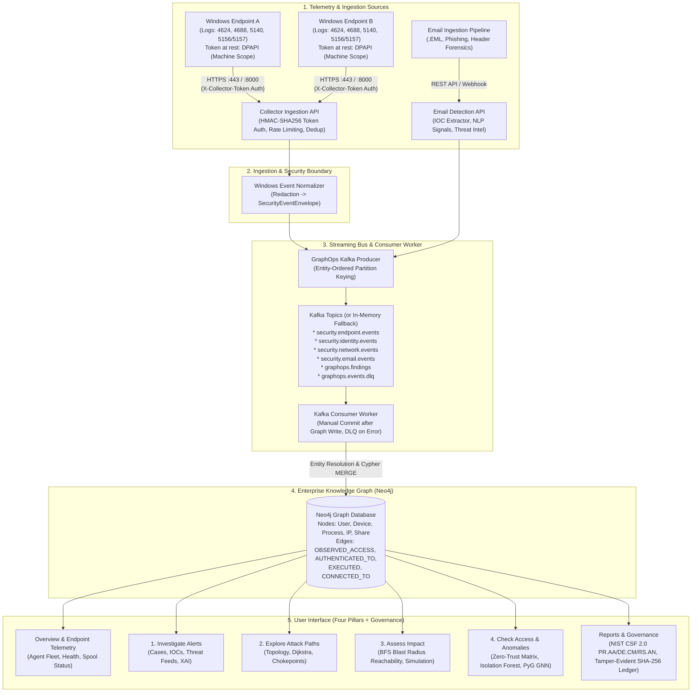

# ThreatLens — Comprehensive Application Overview & Module Architecture

**ThreatLens** is an enterprise-grade **Cyber Threat Investigation, Graph Analytics, and Remote Endpoint Telemetry Platform**. It bridges endpoint security telemetry (Windows Event Logs), inbound communications (Email Forensics), identity access governance (Zero-Trust), and graph-based threat analysis into a unified detection and response fabric.

Instead of treating alerts as isolated log entries, ThreatLens projects every user, device, process, network connection, IP, domain, and file into an **Enterprise Knowledge Graph (Neo4j)**, applying deterministic graph algorithms (**Dijkstra**, **BFS**, **PageRank**, **Betweenness Centrality**) and machine learning (**Isolation Forest**, **PyG Structural GNN**) to trace potential attack trajectories, compute blast radius reachability, and detect lateral movement anomalies in real time.

---

## 1. High-Level Data Journey & System Architecture

---

## 2. Core Concepts: Evidence, Relationships, Paths, and Reachability

To prevent ambiguity during forensic investigations, ThreatLens strictly distinguishes four analytical tiers:

1. **Observed Evidence (Empirical Ground Truth)**: Direct, raw telemetry parsed from authenticated security events (e.g., Windows Event Log 4624 logon, 4688 process creation, or parsed email DKIM headers). Represented in Neo4j with explicit temporal properties (`timestamp`, `source_event_id`).
2. **Inferred Relationships (Entity Resolution)**: Graph connections dynamically derived by correlation rules—such as linking an IP address to a known `:Device` node or matching an email address to a corporate `:User` node.
3. **Potential Attack Paths (Hypothetical Trajectories)**: Calculated by graph algorithms (Dijkstra shortest path, DFS depth-limited traversal). These represent *possible* routes an adversary *could* traverse given current permissions and network topology. They are **not** proof of actual adversary traversal.
4. **Confirmed Compromises**: Nodes explicitly flagged (`compromised: true`) via verified high-severity malware detections, analyst-confirmed incident cases, or synthetic compromise injections.
5. **Blast Radius (Graph Reachability)**: Computed via 1-to-3 hop Breadth-First Search (BFS) starting from a compromised entity. Blast radius quantifies **reachability and theoretical exposure within the modeled graph**, rather than confirmed downstream penetration or active exfiltration.

---

## 3. Deep Dive: Module Operations and UI Architecture

### UI Pillar 0: Overview & Endpoint Telemetry Management
*Primary Files: [`collector/threatlens_collector.py`](file:///C:/Users/Dhayanithi%20M%20U/.gemini/antigravity/worktrees/ThreatLens/remote_windows_log_collection/collector/threatlens_collector.py), [`backend/collector/registry.py`](file:///C:/Users/Dhayanithi%20M%20U/.gemini/antigravity/worktrees/ThreatLens/remote_windows_log_collection/backend/collector/registry.py), [`backend/collector/normalizer.py`](file:///C:/Users/Dhayanithi%20M%20U/.gemini/antigravity/worktrees/ThreatLens/remote_windows_log_collection/backend/collector/normalizer.py), [`backend/api/collector_routes.py`](file:///C:/Users/Dhayanithi%20M%20U/.gemini/antigravity/worktrees/ThreatLens/remote_windows_log_collection/backend/api/collector_routes.py)*

The **Overview Workspace** provides global security posture metrics, high-level summary cards, and the management console for registered Windows endpoints.

* **Collector Device Registry (`backend/collector/registry.py`)**:
  * **Operations**: Enrolls endpoints, generates 288-bit cryptographic tokens (stored at rest on the server as HMAC-SHA256 digests), tracks `last_seen` heartbeats, counts accepted events, and handles instant token revocation.
  * **Concurrency Protection**: Protected by cross-process file locking via `filelock` and atomic `.tmp` file replacement, safely supporting multi-worker Uvicorn configurations.
  * **Auto-Provisioning**: Enrolling an endpoint provisions or updates a `(:Device)` node in Neo4j with its hostname, IP address, and OS metadata.
* **Lightweight Windows Collector (`collector/threatlens_collector.py`)**:
  * **Operations**: Runs as a Windows background Scheduled Task (or interactive console agent). Reads security channel events using `pywin32` with native `wevtutil.exe` XML fallback.
  * **Transport vs. Local Protection**:
    * **Transport Authentication**: Sends batches over HTTPS with HTTP request headers `X-Collector-ID` and `X-Collector-Token`.
    * **At-Rest Protection**: On the endpoint, the token is encrypted on disk in `config.json` via Windows DPAPI (`CryptProtectData`) using machine scope (`CRYPTPROTECT_LOCAL_MACHINE`), allowing the collector task running as `NT AUTHORITY\SYSTEM` to decrypt in memory while NTFS ACLs restrict file read access to `SYSTEM` and `Administrators`.
  * **Durable Spool Queue & Recovery (`SpoolManager`)**:
    * If the network drops or backend is unavailable, incoming events are written to a bounded (20 MB default) disk queue in `C:\ThreatLensCollector\spool`.
    * Spooled batches are drained in FIFO order upon reconnection.
    * Event checkpoints advance only after verified HTTPS acceptance (HTTP 200) or durable on-disk spool persistence, preventing log loss across reboots.
* **Windows Event Normalization & Redaction (`backend/collector/normalizer.py`)**:
  * **Credential Scrubbing**: Sanitizes CLI arguments (`--password`, `-p`, `ghp_token`, `access_token`) on both the collector side and the backend normalizer before Kafka queuing.
  * **Anti-Spoofing Enforcement**: Replaces any claimed computer name with the verified `hostname` bound to the authenticated `collector_id`.
  * **Supported Windows Event IDs**:
    * **Logon & Identity**: Event `4624` (Successful Logon), Event `4625` (Failed Logon), Event `4672` (Special Privileges Assigned).
    * **Process Tracking**: Event `4688` (Process Creation with mandatory Audit Process Creation and command-line logging).
    * **Account Management**: Event `4720` (User Created), Event `4726` (User Deleted), Event `4738` (User Modified).
    * **Network Share Access (Event 5140)**: Windows Security file share object auditing (`\\*\SYSVOL`, `\\*\C$`, `\\*\data`). Captures `SubjectUserName`, `ShareName`, `ShareLocalPath`, client `IpAddress`, and `AccessMask` permissions.
    * **Windows Filtering Platform Network Connections (Events 5156 & 5157)**: Fired by the kernel WFP driver. Event `5156` represents an allowed socket connection (`blocked: false`), while Event `5157` represents a blocked socket connection (`blocked: true`). Captures binary `Application`, `Direction`, `SourceAddress`, `SourcePort`, `DestAddress`, and `DestPort`.

---

### UI Pillar 1: Investigate Alerts (Alerts, Cases & Threat Intel)
*Primary Files: [`backend/services/threat_detection.py`](file:///C:/Users/Dhayanithi%20M%20U/.gemini/antigravity/worktrees/ThreatLens/remote_windows_log_collection/backend/services/threat_detection.py), [`backend/services/email_forensics.py`](file:///C:/Users/Dhayanithi%20M%20U/.gemini/antigravity/worktrees/ThreatLens/remote_windows_log_collection/backend/services/email_forensics.py), [`backend/services/ioc_extractor.py`](file:///C:/Users/Dhayanithi%20M%20U/.gemini/antigravity/worktrees/ThreatLens/remote_windows_log_collection/backend/services/ioc_extractor.py), [`backend/services/threat_intelligence/`](file:///C:/Users/Dhayanithi%20M%20U/.gemini/antigravity/worktrees/ThreatLens/remote_windows_log_collection/backend/services/threat_intelligence/), [`backend/services/explainable_ai.py`](file:///C:/Users/Dhayanithi%20M%20U/.gemini/antigravity/worktrees/ThreatLens/remote_windows_log_collection/backend/services/explainable_ai.py)*

Provides triage capabilities for security analysts investigating suspicious communications, phishing campaigns, and correlated alert cases.

* **Email Forensics & Heuristics (`email_forensics.py`, `nlp_signals.py`)**:
  * Parses raw `.eml` MIME bodies, extracting header routing, SPF/DKIM/DMARC authentication results, and attachment metadata.
  * Evaluates linguistic urgency, payment/gift card solicitation, lookalike spoofing, and CEO impersonation patterns.
* **Automated IOC Extraction & Threat Intelligence Aggregation (`ioc_extractor.py`, `aggregator.py`)**:
  * Extracts IP addresses, domain names, URLs, and SHA-256 hashes using strict regex and validation patterns.
  * Queries external reputation sources (VirusTotal API, AbuseIPDB) with in-memory TTL caching (`cache.py`) to prevent external rate-limit exhaustion.
* **Risk Scoring & Classification (`scoring_engine.py`, `threat_classifier.py`)**:
  * Fuses header signals, NLP scores, and threat intelligence scores into a normalized 0–100 risk score and severity (`LOW`, `MEDIUM`, `HIGH`, `CRITICAL`).
* **Explainable AI (XAI) (`explainable_ai.py`)**:
  * Produces transparent explanations breaking down exactly which factors contributed to an alert score (e.g., "High Risk (88/100): SPF fail, domain registered 2 days ago, and financial wire instructions detected").

---

### UI Pillar 2: Explore Attack Paths (Topology, Dijkstra & Chokepoints)
*Primary Files: [`backend/graphops/dijkstra.py`](file:///C:/Users/Dhayanithi%20M%20U/.gemini/antigravity/worktrees/ThreatLens/remote_windows_log_collection/backend/graphops/dijkstra.py), [`backend/graphops/attack_paths.py`](file:///C:/Users/Dhayanithi%20M%20U/.gemini/antigravity/worktrees/ThreatLens/remote_windows_log_collection/backend/graphops/attack_paths.py), [`backend/graphops/centrality.py`](file:///C:/Users/Dhayanithi%20M%20U/.gemini/antigravity/worktrees/ThreatLens/remote_windows_log_collection/backend/graphops/centrality.py)*

Models network connectivity, privilege relationships, and potential lateral movement routes between assets.

* **Dijkstra Shortest Path Engine (`dijkstra.py`)**:
  * Computes the least-cost potential path between an entry-point node and a high-value crown jewel (e.g. Domain Controller, SQL server).
  * Dynamic edge costs reflect credential exposure, protocol vulnerability, and session hijacking risk.
* **Depth-First Path Traversal (`attack_paths.py`)**:
  * Explores alternative lateral movement branches within configurable depth limits (1–5 hops).
* **Network Centrality & Chokepoint Identification (`centrality.py`)**:
  * Executes **Betweenness Centrality** and **PageRank** algorithms across graph nodes.
  * Pinpoints structural chokepoints—bastion hosts, jump boxes, or service accounts that link otherwise segmented subnets. Isolating an identified chokepoint severs the greatest number of theoretical attack paths.

---

### UI Pillar 3: Assess Impact (Blast Radius & Simulation)
*Primary Files: [`backend/graphops/blast_radius.py`](file:///C:/Users/Dhayanithi%20M%20U/.gemini/antigravity/worktrees/ThreatLens/remote_windows_log_collection/backend/graphops/blast_radius.py), [`backend/graphops/kafka_processor.py`](file:///C:/Users/Dhayanithi%20M%20U/.gemini/antigravity/worktrees/ThreatLens/remote_windows_log_collection/backend/graphops/kafka_processor.py), [`backend/graphops/kafka_simulator.py`](file:///C:/Users/Dhayanithi%20M%20U/.gemini/antigravity/worktrees/ThreatLens/remote_windows_log_collection/backend/graphops/kafka_simulator.py)*

Evaluates the theoretical propagation boundary if a specific identity or machine is compromised.

* **Multi-Hop BFS Blast Radius Engine (`blast_radius.py`)**:
  * Computes Breadth-First Search (BFS) reachability at 1, 2, and 3 hops from a compromised entity.
  * Discovers all potentially exposed assets:
    * **1-Hop Direct Reachability**: Active local sessions, local processes, locally attached shares.
    * **2-Hop Lateral Reachability**: Remote workstations and servers accessible via cached credentials or active firewall rules.
    * **3-Hop Enterprise Reachability**: Critical directory services, enterprise databases, and cloud permissions.
* **Deterministic Event Simulation (`kafka_simulator.py`)**:
  * Generates explicitly labeled synthetic `COMPROMISE_INDICATOR` events for validation and live demonstration. Triggers automatic blast radius calculation through the streaming pipeline without relying on external attacks.

---

### UI Pillar 4: Check Access & Anomalies (Zero-Trust & Graph ML)
*Primary Files: [`backend/graphops/zero_trust.py`](file:///C:/Users/Dhayanithi%20M%20U/.gemini/antigravity/worktrees/ThreatLens/remote_windows_log_collection/backend/graphops/zero_trust.py), [`backend/graphops/anomaly_detection.py`](file:///C:/Users/Dhayanithi%20M%20U/.gemini/antigravity/worktrees/ThreatLens/remote_windows_log_collection/backend/graphops/anomaly_detection.py), [`backend/graphops/pyg_service.py`](file:///C:/Users/Dhayanithi%20M%20U/.gemini/antigravity/worktrees/ThreatLens/remote_windows_log_collection/backend/graphops/pyg_service.py), [`backend/graphops/pyg_model.py`](file:///C:/Users/Dhayanithi%20M%20U/.gemini/antigravity/worktrees/ThreatLens/remote_windows_log_collection/backend/graphops/pyg_model.py)*

Detects policy drift, access discrepancies, and anomalous behavioral patterns across entities.

* **Zero-Trust Access Discrepancy Matrix (`zero_trust.py`)**:
  * Compares observed activity (`:OBSERVED_ACCESS` edges created from telemetry) against baseline authorization (`:AUTHORIZED_ACCESS` edges defined in access policy).
  * Flags **Unauthorized Access Violations** (observed access without authorization) and **Stale Privileges** (granted authorizations unexercised for extended durations).
* **Isolation Forest Anomaly Detection (`anomaly_detection.py`)**:
  * Unsupervised machine learning model identifying tabular anomalies in event velocity, off-hours access, and abnormal process parentage.
* **PyTorch Geometric (PyG) Structural GNN (`pyg_service.py`, `pyg_model.py`)**:
  * Transforms graph subgraphs into PyG tensor structures (feature matrices and edge index tensors).
  * Executes a 2-layer GraphSAGE / GCN neural network to generate structural node embeddings, detecting topological outliers such as rapid hub-and-spoke expansion indicative of automated credential pivoting.

---

### Secondary Workspace: Reports & Governance (Compliance & Audit)
*Primary Files: [`backend/governance/catalog.py`](file:///C:/Users/Dhayanithi%20M%20U/.gemini/antigravity/worktrees/ThreatLens/remote_windows_log_collection/backend/governance/catalog.py), [`backend/governance/evaluator.py`](file:///C:/Users/Dhayanithi%20M%20U/.gemini/antigravity/worktrees/ThreatLens/remote_windows_log_collection/backend/governance/evaluator.py), [`backend/governance/audit.py`](file:///C:/Users/Dhayanithi%20M%20U/.gemini/antigravity/worktrees/ThreatLens/remote_windows_log_collection/backend/governance/audit.py)*

Provides executive compliance evaluations and tamper-evident forensic accounting.

* **NIST CSF 2.0 & CIS Controls Evaluation (`catalog.py`, `evaluator.py`)**:
  * Directly maps graph entities, observed violations, and collector posture against verified security controls:
    * **NIST CSF 2.0 PR.AA-01**: Identity & Credential Management.
    * **NIST CSF 2.0 PR.AA-05**: Access Permissions & Least Privilege.
    * **NIST CSF 2.0 PR.IR-01**: Network & Environment Protection.
    * **NIST CSF 2.0 ID.AM-01**: Hardware Asset Inventory.
    * **NIST CSF 2.0 DE.CM-01**: Continuous Network & Event Monitoring.
    * **NIST CSF 2.0 RS.AN-01**: Incident Analysis & Method Investigation.
    * **CIS Controls v8**: Controls 3, 6, and 8 (Data Protection, Access Management, Audit Log Management).
* **Tamper-Evident SHA-256 Audit Ledger (`audit.py`)**:
  * Every collector enrollment, token revocation, policy modification, and security alert produces a chained record where `record_hash = SHA256(prev_hash + canonical_json(entry))`.
  * Provides cryptographic proof of log sequence integrity. It is software tamper-evident; it does not claim decentralized consensus or hardware WORM immutability.

---

## 4. Streaming Bus & Event Pipeline Architecture

*Primary Files: [`backend/core/config.py`](file:///C:/Users/Dhayanithi%20M%20U/.gemini/antigravity/worktrees/ThreatLens/remote_windows_log_collection/backend/core/config.py), [`backend/graphops/kafka_producer.py`](file:///C:/Users/Dhayanithi%20M%20U/.gemini/antigravity/worktrees/ThreatLens/remote_windows_log_collection/backend/graphops/kafka_producer.py), [`backend/graphops/kafka_worker.py`](file:///C:/Users/Dhayanithi%20M%20U/.gemini/antigravity/worktrees/ThreatLens/remote_windows_log_collection/backend/graphops/kafka_worker.py)*

### Implemented Kafka Topics

| Topic Configuration | Default Topic Name | Event Types Routed / Function | Implementation Status |
|---|---|---|---|
| `KAFKA_TOPIC_ENDPOINT_EVENTS` | `security.endpoint.events` | `ENDPOINT_ALERT`, `PROCESS_EVENT`, `COMPROMISE_INDICATOR` | IMPLEMENTED, UNIT TESTED |
| `KAFKA_TOPIC_IDENTITY_EVENTS` | `security.identity.events` | `IDENTITY_EVENT` (4624/4625 user logons) | IMPLEMENTED, UNIT TESTED |
| `KAFKA_TOPIC_NETWORK_EVENTS` | `security.network.events` | `NETWORK_CONNECTION` (5140 shares, 5156/5157 WFP) | IMPLEMENTED, UNIT TESTED |
| `KAFKA_TOPIC_EMAIL_EVENTS` | `security.email.events` | `EMAIL_INVESTIGATION_RESULT` | IMPLEMENTED, UNIT TESTED |
| `KAFKA_TOPIC_FINDINGS` | `graphops.findings` | Explainable GraphOps security findings | IMPLEMENTED, UNIT TESTED |
| `KAFKA_TOPIC_DLQ` | `graphops.events.dlq` | Poison pills and schema deserialization failures | IMPLEMENTED, UNIT TESTED |

### Production vs. Mock Streaming Behavior

1. **Production Mode (`mock_mode=False`)**:
   * Uses `confluent_kafka.Producer` and `confluent_kafka.Consumer`.
   * Dispatches events to partitions keyed by entity ID (e.g. `device:desktop-01`), ensuring strict per-device event ordering.
   * Consumer worker disables auto-commit (`enable.auto.commit=false`), issuing manual offset commits strictly after graph writes succeed.
   * Corrupt or unparsable payloads are routed to `graphops.events.dlq`.
2. **In-Memory Fallback Mode (`mock_mode=True` or broker unavailable)**:
   * When Kafka broker is unreachable or during unit testing, `GraphOpsKafkaProducer` and `GraphOpsKafkaWorker` automatically switch to thread-safe internal message queues (`self._mock_messages[topic]`).
   * Guarantees 100% of pipeline integration tests and local development workflows succeed without requiring external Kafka broker services.

---

## 5. Verification Status Taxonomy & Component Matrix

To maintain technical accuracy, every component is classified according to the following strict verification hierarchy:
* **`IMPLEMENTED`**: Source code, data schemas, and API contracts exist in the working tree.
* **`UNIT TESTED`**: Automated unit tests pass with isolated mocks.
* **`LOCAL INTEGRATION VERIFIED`**: Multi-component pipelines (Collector $\rightarrow$ Normalizer $\rightarrow$ Kafka $\rightarrow$ Neo4j) executed and verified in test runners.
* **`REMOTE ENDPOINT VERIFIED`**: Collector executed from an independent network location transmitting to an external server.
* **`TWO-PHYSICAL-ENDPOINT VERIFIED`**: Two separate bare-metal or separate hypervisor physical Windows machines concurrently streaming live logs.

| Component / Subsystem | Verification Level | Verification Details |
|---|---|---|
| **Collector Device Registry (`backend/collector/registry.py`)** | `LOCAL INTEGRATION VERIFIED` | Concurrent multi-process enrollment, revocation, and token authentication verified with `filelock` and atomic temp-file replace (`tests/test_registry_concurrency.py`). |
| **Windows Event Normalizer (`backend/collector/normalizer.py`)** | `UNIT TESTED` | Verified across Event IDs 4624, 4625, 4688, 4672, 4720, 4726, 4738, 5140, 5156, and 5157 (`tests/test_windows_normalizer.py`). |
| **Local Spool Queue (`SpoolManager`)** | `UNIT TESTED` | FIFO replay, 20MB capacity limits, and diagnostics verified under network outages (`tests/test_collector_security_and_reliability.py`). |
| **DPAPI Machine-Scope Token Protection** | `UNIT TESTED` | Verified encrypt/decrypt roundtrip under machine scope; restricted NTFS ACLs verified (`tests/test_collector_security_and_reliability.py`). |
| **Dijkstra Attack Path Engine (`dijkstra.py`)** | `LOCAL INTEGRATION VERIFIED` | Shortest path, edge weights, and alternate path discovery passing 13 test cases (`tests/test_dijkstra.py`). |
| **BFS Blast Radius Engine (`blast_radius.py`)** | `LOCAL INTEGRATION VERIFIED` | 1-, 2-, and 3-hop graph reachability passing 16 test cases (`tests/test_blast_radius.py`). |
| **Zero-Trust & Centrality (`zero_trust.py`, `centrality.py`)** | `LOCAL INTEGRATION VERIFIED` | Access discrepancies, PageRank, and Betweenness Centrality passing integration tests (`tests/test_graphops_zero_trust_centrality.py`). |
| **PyG Structural GNN (`pyg_service.py`)** | `LOCAL INTEGRATION VERIFIED` | GraphSAGE embedding generation and topological anomaly classification passing tests (`tests/test_graphops_pyg.py`). |
| **Email Forensics & XAI (`email_forensics.py`)** | `UNIT TESTED` | EML parsing, SPF/DKIM validation, IOC extraction, and XAI explanation generation passing tests (`tests/test_email_forensics.py`, `test_explainable_ai.py`). |
| **Governance Evaluator & Ledger (`catalog.py`, `audit.py`)** | `LOCAL INTEGRATION VERIFIED` | NIST CSF 2.0 PR.AA/DE.CM/RS.AN evaluation and chained SHA-256 ledger tamper-evidence passing 14 test cases (`tests/test_phase6_governance_security.py`). |
| **Dual Endpoint Concurrent Ingestion** | `LOCAL INTEGRATION VERIFIED` | Two simulated endpoints (`DESKTOP-FIN-01`, `DESKTOP-HR-02`) sending distinct event streams concurrently (`tests/test_collector_e2e_simulation.py`). |
| **Two Physical Windows Machines Deployment** | **`UNVERIFIED`** *(Pending Physical Lab Deployment)* | Collector scripts, Caddy/NGINX reverse proxies, and audit policy scripts are deployment-ready, but physical multi-host field deployment has not yet been executed in this environment. |
